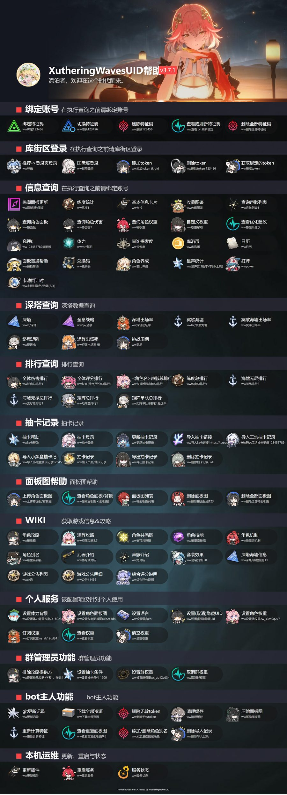

# core-infinity-wavesuid

TelyinCore 的鸣潮（Wuthering Waves）查询插件：把 [XutheringWavesUID](https://github.com/Loping151/XutheringWavesUID)
的能力接进 [TelyinCore](https://github.com/AR15MOD3/TelyinCore) 的 Infinity 插件体系。

> 非官方移植。不是 Telyin 的官方内置插件，也不代表上游作者对本项目背书。

- 版本：0.2.1
- 适用：TelyinCore Infinity API 1
- 许可：本仓库代码 GPL-3.0-or-later；`service/rover/` 来自上游，GPL-3.0（见 [NOTICE.md](NOTICE.md)）



上面这张就是 `ww帮助` 的真实输出：插件把卡片文字抽出来给模型，同时给一个能打开的图片链接
（`mediaFormat=png` 时的样子）。

## 它怎么工作

```
模型 ──waves_command("ww角色面板 椿")──▶ index.py ──HTTP 127.0.0.1:9777──▶ waves service
                                            ◀── summary / segments ───────┘
模型 ◀── 回执：正文 + 卡片文字 + 可打开的链接
```

- **桥接层**（本仓库 `index.py`）：只做三件事——拉起服务、转发命令、把结果折成回执。只用标准库。
- **waves service**（`service/`，独立进程 + 独立 venv）：上游 XutheringWavesUID，加上一层把
  `gsuid_core` 换成 `rover` 的兼容层，对外是本地 FastAPI（`/api/chat`、`/api/commands`、`/api/health`）。

为什么切开：上游要 SQLAlchemy / FastAPI / OpenCV 这一整套，塞进 TelyinCore 的进程会污染它的依赖树；
分进程后服务挂了只影响这一个插件，许可边界也干净。

## 安装

Windows（在插件仓库根目录）：

```powershell
powershell -ExecutionPolicy Bypass -File .\install.ps1
# 想要 PNG 卡片（而不是 HTML 链接）就加 -WithPlaywright
```

从市场装进 `core/extensions/` 时，建议把服务装到 core 外面，别让 venv 和上游仓库落在 core 的目录树里：

```powershell
powershell -ExecutionPolicy Bypass -File .\install.ps1 -ServiceDir D:\TelyinCore\waves-service
```

Linux / macOS：

```sh
./install.sh              # 加 --playwright 装 Chromium
```

脚本会：装 uv/git 检查 → 建 `service/.venv`（Python 3.10–3.13）→ 装依赖 →
拉 XutheringWavesUID / RoverSign / ScoreEcho → 写插件 `config.json`（`autoStart = true`）。

它不会后台常驻、不会碰你的账号；账号数据只在 `service/data/` 里。

首次启动服务时会从镜像下载游戏素材（数百 MB，后台进行，日志在 `service/data/logs/`）。

然后把仓库放进 `<TelyinCore>/extensions/core-infinity-wavesuid/`，在插件页启用即可。

## 配置

| 字段 | 说明 | 默认 |
|---|---|---|
| `host` | 服务监听地址，只允许本机 | `127.0.0.1` |
| `port` | 服务端口 | `9777` |
| `autoStart` | 由插件拉起服务，停用/重载时一并结束 | `false`（安装脚本会写成 `true`） |
| `python` | 服务用解释器（`service/.venv` 里那个） | 空 |
| `serviceDir` | 包含 `rover/main.py` 的目录 | 空（不填则用插件目录下 `service/`） |
| `mediaFormat` | 卡片链接给 `html` 还是 `png`；png 需要 Playwright | `html` |
| `scene` | `group` / `direct`，少数命令需要 direct | `group` |
| `commandTimeout` | 单条命令超时（秒） | `90` |

配置写坏（非法 JSON）时，`waves_status` 会明说哪一份坏了，不会静默退回默认值。

## 工具

| 工具 | 说明 |
|---|---|
| `waves_command` | 执行一条鸣潮命令，回执含正文、卡片文字与链接。绑定/签到/导入会真实改变账号状态，调用前应先与用户确认 |
| `waves_help` | 不给 topic 时返回上游那张帮助目录；给 topic（深渊/抽卡/排行/体力…）则列出相关命令词 |
| `waves_status` | 服务是否在线、命令条数、是否由本插件启动、配置有没有问题 |

为什么不做成 86 个工具：上游接口本身就是命令式的（前缀 + 别名 + 正则），拆开等于重写一遍解析；
一个命令总线能跟着上游升级，命令词变了只改帮助文本。

## 用之前要知道的两件事

1. **第一次用账号类功能要先绑定**：`ww绑定<9位UID>`；查体力/签到还要先 `ww登录`（库街区）。
   不绑定也能查的：`ww帮助`、`ww日历`、卡池倒计时、角色/武器/声骸百科等。
2. **图片到不了 QQ**：TelyinCore 的 QQ 通道目前只能回发"收到过的图"。回执里给的是
   `http://127.0.0.1:9777/api/media/...` 链接，浏览器能打开。要真发图需要内核增加出站媒体能力
   （见 `docs/DESIGN.md`）。

## 已知限制

- 服务要自己装（首次几百 MB）：仓库里不塞上游代码、素材和模型。
- `service/rover/` 是固定版本的上游兼容层，上游更新需要按 `service/UPSTREAM.md` 同步。
- 不做安全隔离：插件与上游都在本机以当前用户身份运行，启用前请自行确认来源。
- 上游命令里带正则触发器的部分（如按角色名模糊匹配）`waves_help` 不列，但照样能用。

## 许可与署名

- 本仓库桥接层：**GPL-3.0-or-later**。
- `service/rover/`、`service/tools/`：来自 [dsh-plugin-waves](https://github.com/Loping151/dsh-plugin-waves)，
  **GPL-3.0**，作者 Loping151，固定 commit 与同步方法见 [service/UPSTREAM.md](service/UPSTREAM.md)。
- 运行时拉取的 XutheringWavesUID / RoverSign / ScoreEcho：GPL-3.0-or-later，作者 tyql688 / Loping151。
- 两部分一起分发时按 GPL-3.0 理解。详见 [NOTICE.md](NOTICE.md)。
